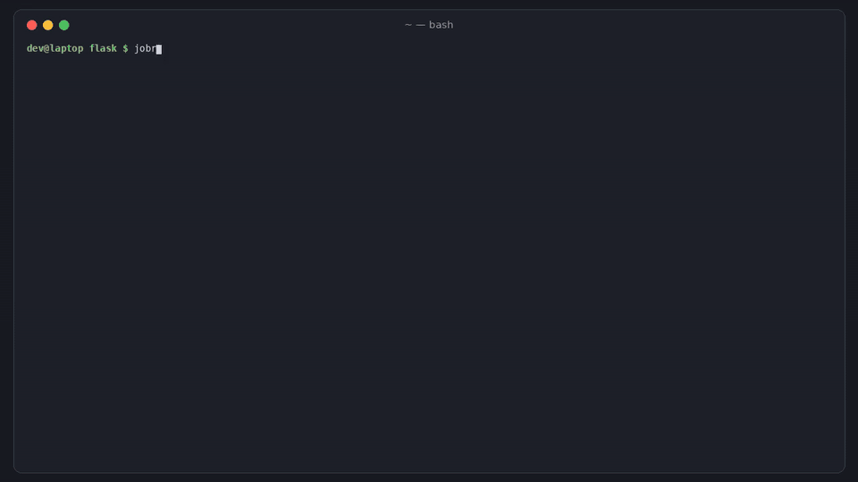

# jobrepro

[](https://github.com/hamarshehmhmd/jobrepro/actions/workflows/ci.yml)
[](LICENSE)


**Re-run one GitHub Actions job, or one step, on your own machine, and get a shell in the failing step's environment. No more push-and-wait.**

A CI step fails. To find out why, you edit the workflow, push, wait a few minutes, read the log, and do it again. Lots of people hit this. ["The Pain That Is GitHub Actions"](https://news.ycombinator.com/item?id=43419701) got **704 points and 562 comments** on Hacker News, ["How can I run GitHub Actions workflows locally?"](https://stackoverflow.com/questions/59241249/how-can-i-run-github-actions-workflows-locally) has **324k views**, and the usual workaround, SSH into the runner with `action-tmate`, [stopped working when the tmate servers shut down](https://ddev.com/blog/tmate-github-actions-contributor-training/).

`jobrepro` reads your workflow file and runs the steps of **one job** in your checkout, the way the runner would. It evaluates `${{ }}` expressions (matrix, `steps.*.outputs`, `env`, `secrets`, `inputs`, `hashFiles()`, `success()`/`failure()`...), handles `GITHUB_ENV` / `GITHUB_OUTPUT` / `GITHUB_PATH`, the default shells and `defaults.run`, local composite actions, `continue-on-error`, `timeout-minutes` and the `::add-mask::` / `::group::` / `::error::` commands. On top of that you get:

- **Breakpoints.** `--break 4` opens a shell right before step 4, with that step's env and working directory. `--break-on-failure` opens one when a step fails. Fix the problem, exit, and **retry just that step**.
- **From a failed run to a local command.** `jobrepro from-run <run URL>` finds the failed job, its matrix values and the step that broke, then prints the exact command to run it locally.
- **Step selection.** `--only`, `--from`, `--until`, `--skip`, using a step number, its `id`, or part of its name.
- **Plain processes by default, Docker if you want it.** Steps run as normal processes on your machine, so it's fast and your local tools and caches just work. Add `--image ubuntu:24.04` (or rely on a job's own `container:`) to run them in a container.



```sh
curl -fsSL https://raw.githubusercontent.com/hamarshehmhmd/jobrepro/main/install.sh | sh
```

(or `pipx install git+https://github.com/hamarshehmhmd/jobrepro` / `uv tool install git+https://github.com/hamarshehmhmd/jobrepro`. Python 3.9+, the only dependency is PyYAML. Linux and macOS.)

## Quick start

```sh
cd your-repo
jobrepro list --steps                         # workflows, jobs, matrix combinations, numbered steps
jobrepro run ci.yml:test --matrix python=3.12 # run that job's steps here
jobrepro run test --break-on-failure          # shell in the failing step, then [r]etry / [c]ontinue / [a]bort
```

### Reproduce a red CI run

Here's a real failed run on `pallets/flask`:

```console
$ jobrepro from-run https://github.com/pallets/flask/actions/runs/37633292268
run      https://github.com/pallets/flask/actions/runs/37633292268
         fix dev  (push on main @ 329c32b916)
job      typing  ->  .github/workflows/tests.yaml:typing
failed   Run uv run --locked --no-default-groups --group dev tox run -e typing  (step 5)
runs-on  ubuntu-latest

# your checkout is not at the failing commit; get a clean copy of it:
git fetch origin 329c32b9... && git worktree add ../flask-329c32b9 329c32b9... && cd ../flask-329c32b9
# re-run the job up to the failed step; a failure opens a shell in that step's env:
jobrepro run .github/workflows/tests.yaml:typing --until 5 --break-on-failure
```

Running that command in the worktree reproduces the same mypy error as CI in about 6 seconds. `from-run` uses your logged-in `gh` CLI. It maps GitHub's job display names (`test (3.12, ubuntu-latest)`, `name: ${{ matrix.name }}`, include-only matrices) back to the job id and the smallest set of `--matrix` flags that pick out that combination.

### Debug one step

```console
$ jobrepro run test -m python=3.13 --only "Run tests" -B
[6] Run tests
  error (file=config.ini): config.ini is missing
  step 6 failed (exit 1). Opening a shell in its env and cwd.
[jobrepro] ~/shop $ printf '[shop]\ncurrency = EUR\n' > config.ini
[jobrepro] ~/shop $ exit
  retry/continue/abort? [r/c/A] r
  OK
  ok (0.0s)
```

Inside the shell, `$JOBREPRO_STEP_SCRIPT` is the rendered step script, so you can edit it and run it again yourself.

### Everything else

```sh
jobrepro plan test -m python=3.13              # dry run: print each rendered script, env and shell
jobrepro run test --secret API_TOKEN=xyz       # secrets are masked as *** in the output
jobrepro run test --secrets-file .secrets      # dotenv file; missing secrets are empty and listed
jobrepro run deploy --event pull_request --event-file pr.json --var REGION=eu
jobrepro run release --set needs.build.outputs.version=1.2.3   # override any context value
jobrepro run test --image ubuntu:24.04         # run the steps inside a container (docker)
```

Exit code is `0` when the job succeeds, `1` when a step fails, `2` for usage or workflow errors.

## How `uses:` steps are handled

| step | what happens locally |
| --- | --- |
| `actions/checkout` | skipped: your working tree is the checkout |
| `actions/setup-python` / `setup-node` / `setup-go` | checks the version on your machine. For Python it puts the matching `pythonX.Y` first on `PATH`, and it warns when the version doesn't match |
| `actions/cache`, `upload-artifact`, `download-artifact` | skipped (your local files and caches are already there) |
| `./local/composite-action` | **run**, with `inputs`, defaults, `outputs` and `GITHUB_ACTION_PATH` |
| any other remote JavaScript/Docker action | skipped with a warning, and listed in the summary |

## Limits (on purpose)

- It doesn't emulate the whole runner. Remote JavaScript and Docker actions aren't executed, and `services:` aren't started (you get a warning, so start them with `docker run`). `needs:` outputs come from `--set`. For whole-workflow emulation, use [nektos/act](https://github.com/nektos/act).
- By default, steps run with your machine's toolchain and OS. That's what makes it fast, but it also means "works with jobrepro" isn't proof it passes on GitHub's `ubuntu-latest`. Use `--image` to get closer.
- Windows runners and `pwsh`-only steps aren't a target yet.
- Secrets are masked in jobrepro's own output. In `--image` mode they're passed to `docker exec` as `-e` arguments.

## Development

```sh
python -m venv .venv && . .venv/bin/activate
pip install -e . pytest
pytest -q            # the container test runs when docker is available
```

CI runs the tests on Linux (Python 3.9 to 3.13) and macOS. It runs the container-mode test against real Docker, runs jobrepro on this repo's own `test` job, and tests the one-line installer in a clean runner.

## License

GNU Affero General Public License v3.0 or later (`AGPL-3.0-or-later`), see [LICENSE](LICENSE).
**Commercial licenses** without the AGPL obligations are available from the author, Mohammad Hamarsheh ([@hamarshehmhmd](https://github.com/hamarshehmhmd)).
